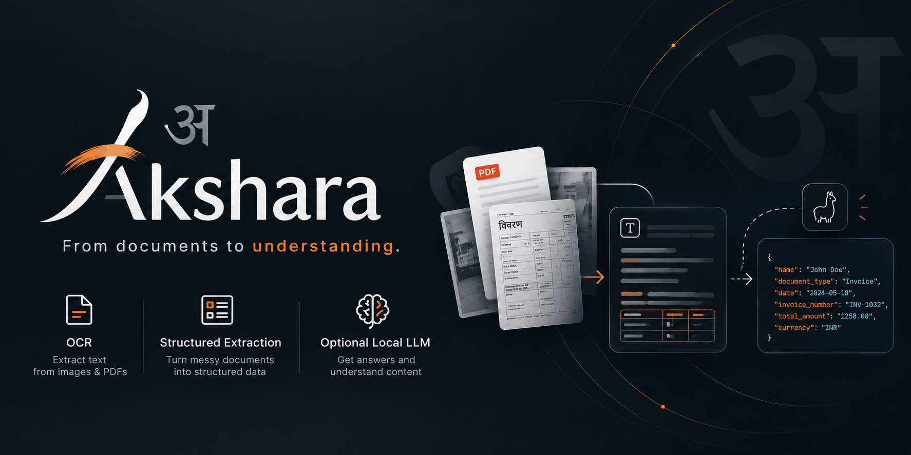

<h1 align="center">Akshara | अक्षर</h1>
<p align="center"><strong>From text to understanding.</strong></p>

<div align="center">

[](https://github.com/nikhil25803/akshara/actions/workflows/test.yml)
[](https://github.com/nikhil25803/akshara/actions/workflows/build.yml)
[](https://github.com/nikhil25803/akshara/releases)
[](https://www.python.org/)
[](https://fastapi.tiangolo.com/)
[](https://github.com/PaddlePaddle/PaddleOCR)
[](https://github.com/ggml-org/llama.cpp)
[](LICENSE)

<br>


</div>

## Table of contents

- [About](#about)
- [Features and roadmap](#features-and-roadmap)
- [Tech stack](#tech-stack)
- [Docker installation](#docker-installation)
- [Environment configuration](#environment-configuration)
- [API documentation](#api-documentation)
- [Local development](#local-development)
- [Deployment resources](#deployment-resources)
- [Supported OCR languages](#supported-ocr-languages)
- [Project](#project)

## About

OCR can recover text, but applications need meaning, such as identifying the
licence number or expiry date instead of returning every string on a driving
licence. Building that understanding usually requires separate systems for
layout parsing, schema mapping, retrieval, models, and chat sessions.

Akshara aims to provide that pipeline behind one local API, supporting fixed
schemas, direct document questions, and temporary real-time chat without
requiring users to operate external retrieval or vector infrastructure.

Version 0.0.1 delivers the secure OCR foundation: PDF and image extraction,
multilingual configuration, upload validation, authentication, limits, and CPU
Docker deployment. Semantic extraction, in-memory retrieval, and WebSocket chat
are planned for future releases.

## Features and roadmap

| Capability                                                           | Status        |
| -------------------------------------------------------------------- | ------------- |
| JPEG, PNG, and PDF OCR                                               | **Available** |
| Embedded PDF text with scanned-page OCR fallback                     | **Available** |
| Environment-controlled multilingual OCR                              | **Available** |
| API-key authentication and upload/resource limits                    | **Available** |
| CPU Docker deployment with persistent model caching                  | **Available** |
| Caller-defined fixed-schema extraction                               | **Upcoming**  |
| Direct questions against an uploaded document                        | **Upcoming**  |
| In-memory retrieval without an external vector database              | **Upcoming**  |
| Session-scoped WebSocket chat (`ws://` locally, `wss://` behind TLS) | **Upcoming**  |
| Local llama.cpp-assisted document answers                            | **Upcoming**  |

<a id="tech-stack"></a>

## 🛠 Tech Stack

| Layer                  | Technology                           |
| ---------------------- | ------------------------------------ |
| Runtime                | Python 3.11+                         |
| API framework          | FastAPI                              |
| ASGI server            | Uvicorn                              |
| OCR engine             | PaddleOCR 3.x + PaddlePaddle 3.2 CPU |
| Document processing    | PyMuPDF + Pillow                     |
| Configuration          | Pydantic Settings                    |
| Dependency management  | uv                                   |
| Testing and linting    | pytest + Ruff                        |
| Container and registry | Docker + GitHub Container Registry   |
| CI/CD                  | GitHub Actions                       |

## Docker installation

Pull the most recent stable CPU image:

```bash
docker pull ghcr.io/nikhil25803/akshara:latest
```

After creating the `.env` file described below, run:

```bash
docker run --rm -p 8000:8000 \
  --env-file .env \
  --volume akshara-models:/models \
  ghcr.io/nikhil25803/akshara:latest
```

Use `ghcr.io/nikhil25803/akshara:0.0.1` instead of `:latest` for a
reproducible deployment. The image currently targets `linux/amd64` and contains
both PaddleOCR and the CPU PaddlePaddle runtime. The first configured OCR
language downloads and initializes before the service becomes healthy. Its
model persists in the writable `/models` volume; additional enabled languages
remain lazy and download on first use. An empty model cache therefore increases
cold startup time.

## Environment configuration

Copy the example when running from a repository checkout:

```bash
cp .env.example .env
make generate-key
```

Save the generated value as `API_KEY` in `.env`. The command uses Python's
standard-library `secrets` module, any strong value of at least 32 characters is
valid.

| Variable                      | Default    | Purpose                                                                         |
| ----------------------------- | ---------- | ------------------------------------------------------------------------------- |
| `API_KEY`                     | required   | Key of at least 32 characters, protects every endpoint except `/` and `/health` |
| `OCR_LANGUAGES`               | `en,hi`    | Language allowlist; the first entry is the request default and startup preload  |
| `OCR_MAX_CONCURRENT_REQUESTS` | `1`        | Maximum simultaneous OCR operations per process                                 |
| `MAX_FILE_SIZE_MB`            | `25`       | Maximum uploaded file size                                                      |
| `MAX_PDF_PAGES`               | `50`       | Maximum pages per PDF                                                           |
| `MAX_IMAGE_PIXELS`            | `25000000` | Maximum pixels per image or rendered PDF page                                   |
| `ENABLE_LLM`                  | `false`    | Reserved for the upcoming local LLM feature, keep disabled                      |

## API documentation

| Request        | Description                           | Example                                                                                    |
| -------------- | ------------------------------------- | ------------------------------------------------------------------------------------------ |
| `GET /`        | Service metadata and enabled features | `curl http://localhost:8000/`                                                              |
| `GET /health`  | PaddleOCR runtime readiness           | `curl http://localhost:8000/health`                                                        |
| `POST /v1/ocr` | Extract text from a JPEG, PNG, or PDF | `curl -X POST -H "api_key: $API_KEY" -F "file=@document.pdf" http://localhost:8000/v1/ocr` |

`POST /v1/ocr` accepts one `file` field as `multipart/form-data`. Filenames and
client MIME declarations are not trusted. Select one configured OCR language
with `language`, it defaults to the first value in `OCR_LANGUAGES`.

| Query parameter     | Default                   | Effect                                                |
| ------------------- | ------------------------- | ----------------------------------------------------- |
| `language`          | first configured language | Selects one enabled PaddleOCR language                |
| `page_details`      | `false`                   | Includes text for each page                           |
| `extraction_source` | `false`                   | Includes `embedded_text` or `paddleocr` for each page |
| `coordinates`       | `false`                   | Includes normalized `0..1` text polygons              |

Example with every optional detail:

```bash
curl -X POST \
  "http://localhost:8000/v1/ocr?language=hi&page_details=true&extraction_source=true&coordinates=true" \
  -H "api_key: $API_KEY" \
  -F "file=@document.png"
```

The base response contains `text`, `language`, detected `mime_type`,
`page_count`, and `warnings`. Typical failures are `401` for authentication,
`400` for malformed documents, `413` for configured limits, `415` for
unsupported or spoofed content, `422` for an unavailable language, `429` when
OCR is busy, and `503` when PaddleOCR is unavailable.

`GET /health` returns HTTP `200` with `{"status":"ok","paddleocr":true}` only
after the default language pipeline is initialized. While it is loading, or if
initialization fails, health returns HTTP `503` with
`{"status":"degraded","paddleocr":false}`. For container orchestration, use `/`
as the liveness check and `/health` as the readiness check.

## Local development

Requirements: Python 3.11+, [uv](https://docs.astral.sh/uv/), and Make.

```bash
git clone https://github.com/nikhil25803/akshara.git
cd akshara
uv sync --locked
cp .env.example .env
make generate-key
make run
```

Put the generated key in `.env` before starting the server. Full PaddlePaddle
inference is provided by the Linux Docker image, a development environment
without that runtime starts in degraded mode.

Run the complete local check suite with:

```bash
make check
```

## Deployment resources

These CPU starting points assume `ENABLE_LLM=false` and
`OCR_MAX_CONCURRENT_REQUESTS=1`:

| Profile                   | CPU    | Memory | Intended use                                 |
| ------------------------- | ------ | ------ | -------------------------------------------- |
| Minimum                   | 1 vCPU | 2 GiB  | Development and small documents              |
| Production starting point | 2 vCPU | 4 GiB  | Safer baseline for one OCR request at a time |

Large PDFs, high pixel limits, additional cached languages, or higher
concurrency require workload-specific testing and larger limits.

Use a persistent `/models` volume in production. With an empty or ephemeral
volume, every replacement container must download the default server model
before it becomes ready.

## Supported OCR languages

Hindi uses `hi`, not `hn`. Every language used by a request can download and
retain an additional model in `/models`.

<details>
<summary>Show every supported PaddleOCR language code</summary>

`abq`, `af`, `ang`, `ar`, `ava`, `az`, `be`, `bg`, `bgc`, `bh`, `bho`, `bs`, `ch`, `che`, `chinese_cht`, `cs`, `cy`, `da`, `dar`, `de`, `en`, `es`, `et`, `fa`, `fr`, `ga`, `gom`, `hi`, `hr`, `hu`, `id`, `inh`, `is`, `it`, `japan`, `ka`, `kbd`, `korean`, `ku`, `la`, `lbe`, `lez`, `lt`, `lv`, `mah`, `mai`, `mi`, `mn`, `mr`, `ms`, `mt`, `ne`, `new`, `nl`, `no`, `oc`, `pi`, `pl`, `pt`, `ro`, `rs_cyrillic`, `rs_latin`, `ru`, `sa`, `sck`, `sk`, `sl`, `sq`, `sv`, `sw`, `tab`, `ta`, `te`, `tl`, `tr`, `ug`, `uk`, `ur`, `uz`, `vi`

</details>

## Project

- See [CHANGELOG.md](CHANGELOG.md) for release history.
- Akshara is distributed under the [MIT License](LICENSE).
