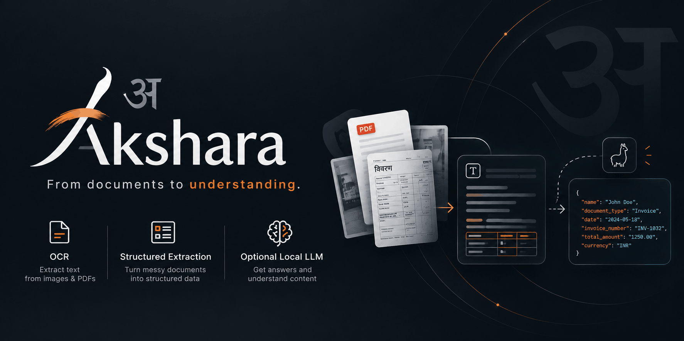

<h1 align="center">Akshara | अक्षर</h1>
<p align="center"><strong>From text to understanding.</strong></p>

<div align="center">

[](https://github.com/nikhil25803/akshara/actions/workflows/test.yml)
[](https://github.com/nikhil25803/akshara/actions/workflows/build.yml)
[](https://github.com/nikhil25803/akshara/releases)
[](https://www.python.org/)
[](https://fastapi.tiangolo.com/)
[](https://github.com/PaddlePaddle/PaddleOCR)
[](https://github.com/ggml-org/llama.cpp)
[](LICENSE)

<br>


</div>

## Table of contents

- [About](#about)
- [Quick start](#quick-start)
- [Tech Stack](#tech-stack)
- [Environment configuration](#environment-configuration)
- [API documentation](#api-documentation)
- [More examples](#more-examples)
- [Local development](#local-development)
- [Deployment resources](#deployment-resources)
- [Supported OCR languages](#supported-ocr-languages)
- [Features and roadmap](#features-and-roadmap)
- [Project](#project)

## About

OCR can recover text, but applications need meaning, such as identifying the
licence number or expiry date instead of returning every string on a driving
licence. Building that understanding usually requires separate systems for
layout parsing, schema mapping, retrieval, models, and chat sessions.

Akshara aims to provide that pipeline behind one local API, supporting fixed
schemas, direct document questions, and temporary real-time chat without
requiring users to operate external retrieval or vector infrastructure.

Akshara provides the secure OCR foundation plus optional, caller-defined JSON
Schema extraction through a local llama.cpp model. Retrieval, direct document
questions, and WebSocket chat are planned for future releases.

## Quick start

Install [Docker](https://docs.docker.com/get-started/get-docker/), then clone the
repository so the sample documents are available:

```bash
git clone https://github.com/nikhil25803/akshara.git
```

```bash
cd akshara
```

```bash
export API_KEY="$(openssl rand -hex 32)"
```

```bash
mkdir -p models
```

```bash
docker pull ghcr.io/nikhil25803/akshara:latest
```

Start the OCR service:

```bash
docker run --detach --rm --name akshara \
  --publish 8000:8000 \
  --env API_KEY \
  --env ENABLE_LLM=false \
  --env OCR_LANGUAGES=en \
  --volume "$PWD/models:/models" \
  ghcr.io/nikhil25803/akshara:latest
```

The image targets `linux/amd64`. PaddleOCR weights download during the first
startup, so follow progress with `docker logs -f akshara` before checking the
service. Use `ghcr.io/nikhil25803/akshara:0.0.3` instead of `:latest` when a
deployment must remain pinned to this release.

### `GET /health`

```bash
curl --request GET "http://127.0.0.1:8000/health"
```

<details>
<summary>Response</summary>

```json
{
  "status": "ok",
  "paddleocr": true
}
```

</details>

### `POST /v1/ocr`

```bash
curl --request POST \
  --header "api_key: $API_KEY" \
  --form "file=@assets/test/driving-licence.jpg" \
  "http://127.0.0.1:8000/v1/ocr?language=en&extraction_source=true"
```

<details>
<summary>JPEG OCR response</summary>

```json
{
  "text": "INDIAN UNION\nKERALA STATE\nDRIVING LICENCE\nHOM\nNo.: 5/0000/2010\nDate:\n02/02/2010\nName\nSAMPLE PERSON\nS/W/D of\nSAMPLE PERSON\nAddress\n:SAMPLE ADDRESS LINE 1\nADDRESS LINE 2\nADDRESS LINE 3\nDate of Birth\n:01/01/1991\nBlood Group\n:B+\nCategory\nValid from\nValid To\nNon-Transport\n02/02/2010\n01/02/2030\nTransport",
  "language": "en",
  "mime_type": "image/jpeg",
  "page_count": 1,
  "warnings": [],
  "pages": [
    {
      "page_number": 1,
      "extraction_source": "paddleocr"
    }
  ]
}
```

</details>

### Enable schema extraction

Stop the OCR-only container, download the same compact model used by CI, and
restart with llama.cpp enabled:

```bash
docker stop akshara
```

```bash
curl --location \
  --output models/model.gguf \
  "https://huggingface.co/Qwen/Qwen2.5-0.5B-Instruct-GGUF/resolve/9217f5db79a29953eb74d5343926648285ec7e67/qwen2.5-0.5b-instruct-q4_k_m.gguf"
```

```bash
docker run --detach --rm --name akshara \
  --publish 8000:8000 \
  --env API_KEY \
  --env ENABLE_LLM=true \
  --env OCR_LANGUAGES=en \
  --env LLM_BACKEND=llama_cpp \
  --env LLM_MODEL_PATH=/models/model.gguf \
  --env LLM_DEVICE=cpu \
  --volume "$PWD/models:/models" \
  ghcr.io/nikhil25803/akshara:latest
```

When `GET /health` reports `"llama_cpp": true`, schema extraction is ready.

<details>
<summary>Schema-enabled health response</summary>

```json
{
  "status": "ok",
  "paddleocr": true,
  "llama_cpp": true
}
```

</details>

### `POST /v1/ocr/schema`

```bash
curl --request POST \
  --header "api_key: $API_KEY" \
  --form "file=@assets/test/driving-licence.jpg" \
  --form 'schema={"type":"object","properties":{"issue_date":{"type":"string","description":"The licence issue date exactly as written in the document"},"date_of_expiry":{"type":"string","description":"The licence expiry date exactly as written in the document"}},"required":["issue_date","date_of_expiry"],"additionalProperties":false};type=application/json' \
  "http://127.0.0.1:8000/v1/ocr/schema?language=en"
```

<details>
<summary>Licence schema response</summary>

```json
{
  "issue_date": "02/02/2010",
  "date_of_expiry": "01/02/2030"
}
```

</details>

## Tech Stack

| Layer                  | Technology                           |
| ---------------------- | ------------------------------------ |
| Runtime                | Python 3.11+                         |
| API framework          | FastAPI                              |
| ASGI server            | Uvicorn                              |
| OCR engine             | PaddleOCR 3.x + PaddlePaddle 3.2 CPU |
| Document processing    | PyMuPDF + Pillow                     |
| Structured extraction  | llama.cpp + JSON Schema              |
| Configuration          | Pydantic Settings                    |
| Dependency management  | uv                                   |
| Testing and linting    | pytest + Ruff                        |
| Container and registry | Docker + GitHub Container Registry   |
| CI/CD                  | GitHub Actions                       |

## Environment configuration

Copy the example when running from a repository checkout:

```bash
cp .env.example .env
```

```bash
make generate-key
```

Save the generated value as `API_KEY` in `.env`. The command uses Python's
standard-library `secrets` module, any strong value of at least 32 characters is
valid.

| Variable                      | Default               | Purpose                                                                         |
| ----------------------------- | --------------------- | ------------------------------------------------------------------------------- |
| `API_KEY`                     | required              | Key of at least 32 characters, protects every endpoint except `/` and `/health` |
| `OCR_LANGUAGES`               | `en,hi`               | Comma-separated language allowlist, the first language is the request default   |
| `OCR_MAX_CONCURRENT_REQUESTS` | `1`                   | Maximum simultaneous OCR operations per process                                 |
| `MAX_FILE_SIZE_MB`            | `25`                  | Maximum uploaded file size                                                      |
| `MAX_PDF_PAGES`               | `50`                  | Maximum pages per PDF                                                           |
| `MAX_IMAGE_PIXELS`            | `25000000`            | Maximum pixels per image or rendered PDF page                                   |
| `ENABLE_LLM`                  | `false`               | Enables JSON Schema extraction through llama.cpp                                |
| `LLM_BACKEND`                 | `llama_cpp`           | Local inference backend                                                         |
| `LLM_MODEL_PATH`              | `./models/model.gguf` | Path to the GGUF model                                                          |
| `LLM_DEVICE`                  | `cpu`                 | Inference device; Linux AMD64 CPU is currently supported                        |

## API documentation

### `GET /`

Returns service metadata and enabled features. This endpoint does not require
authentication.

### `GET /health`

Reports PaddleOCR readiness and, when enabled, llama.cpp readiness. This
endpoint does not require authentication.

### `POST /v1/ocr`

Extracts text from a JPEG, PNG, or PDF supplied as the `file` field in a
`multipart/form-data` request. Filenames and client MIME declarations are not
trusted. The `language` query parameter selects one configured OCR language and
defaults to the first value in `OCR_LANGUAGES`.

| Query parameter     | Default                   | Effect                                                |
| ------------------- | ------------------------- | ----------------------------------------------------- |
| `language`          | first configured language | Selects one enabled PaddleOCR language                |
| `page_details`      | `false`                   | Includes text for each page                           |
| `extraction_source` | `false`                   | Includes `embedded_text` or `paddleocr` for each page |
| `coordinates`       | `false`                   | Includes normalized `0..1` text polygons              |

Request every optional detail with:

```bash
curl -X POST \
  "http://localhost:8000/v1/ocr?language=hi&page_details=true&extraction_source=true&coordinates=true" \
  -H "api_key: $API_KEY" \
  -F "file=@document.png"
```

The base response contains `text`, `language`, detected `mime_type`,
`page_count`, and `warnings`. Typical failures are `401` for authentication,
`400` for malformed documents, `413` for configured limits, `415` for
unsupported or spoofed content, `422` for an unavailable language, `429` when
OCR is busy, and `503` when PaddleOCR is unavailable.

### `POST /v1/ocr/schema`

Accepts the same `file` plus a standard JSON Schema in the `schema` form field.
The root schema must be an object and references are not supported. The response
is exactly the schema-shaped object, without raw OCR text or metadata.

Callers should allow `null` in their schema for values that may be absent. The
service does not alter schemas or invent fallback values. Invalid schemas return
`422`, busy inference returns `429`, invalid model output returns `502`, and a
disabled or unavailable model returns `503`.

## More examples

These examples use the test documents included in this repository. OCR output
can vary slightly across PaddleOCR or model versions.

### PNG OCR — `POST /v1/ocr`

```bash
curl --request POST \
  --header "api_key: $API_KEY" \
  --form "file=@assets/test/quote.png" \
  "http://127.0.0.1:8000/v1/ocr?language=en&extraction_source=true"
```

<details>
<summary>PNG OCR response</summary>

```json
{
  "text": "\"It was the best of times, it was the\nworst of times, it was the age of\nwisdom, it was the age of\nfoolishness...\"\nCharles Dickens\nA Tale of Two Cities, 1859",
  "language": "en",
  "mime_type": "image/png",
  "page_count": 1,
  "warnings": [],
  "pages": [
    {
      "page_number": 1,
      "extraction_source": "paddleocr"
    }
  ]
}
```

</details>

### PDF OCR — `POST /v1/ocr`

```bash
curl --request POST \
  --header "api_key: $API_KEY" \
  --form "file=@assets/test/NikhilRaj_Resume_SDE.pdf" \
  "http://127.0.0.1:8000/v1/ocr?language=en&extraction_source=true"
```

<details>
<summary>Full PDF OCR response</summary>

```json
{
  "text": "Nikhil Raj\n\n      \u0083 +91-7004121281 # nikhil25803@gmail.com \u00ef LinkedIn \u00a7 Github    LeetCode\n\n\nEducation\n\nHeritage Institute of Technology                                          October 2021 – June 2025\n\nBachelor of Technology - Computer Science and Engineering (with AI and ML) DGPA: 8.05                   Kolkata, India\n\nExperience\n\nCautio                                                                              July 2025 – Present\n\nSoftware Development Engineer                                                                           Bengaluru\n    • Architected and deployed a real-time video streaming and two-way audio communication system using Go, FFmpeg,\n    and EMQX (MQTT), ingesting and processing binary IoT streams at 300 GB/day (9 TB/month).\n    • Deployed ML models and built Python-based Kafka consumers with Celery for background processing to validate\n   1M+ IoT-generated alert images daily, filtering 70K+ noisy or invalid alerts to reduce false positives.\n    • Developed a high-throughput geofencing system using Node.js, TypeScript, PostgreSQL/PostGIS, and\n   MongoDB to evaluate 20M+ GPS pings/day through real-time spatial queries and low-latency alerting.\n    • Engineered a distributed image-to-video pipeline that processed 200K+ images/day, orchestrating frame sequencing\n    and efficient video stitching through parallel, asynchronous execution.\n\nMswasth Tech Pvt Ltd.                                                           April 2024 – July 2024\nSoftware Engineer Intern | Link                                                                      Remote\n    • Developed 10+ end-to-end endpoints using Django DRF, MySQL, and Redis with integration of ABDM APIs.\n    • Created robust data-driven workflows to process 500+ health records daily using Celery for background task\n     management, and Pipedream for data integration enhancing overall operational efficiency.\n    • Deployed an end-to-end consent flow, handling health record data in FHIR format, including Fidelius encryption and\n     decryption for secure client-side display.\nProjects\n\n Review It | Python, Django Rest Framework, React.js, TailwindCSS, Firebase, PostgreSQL                 GitHub\n    • Created a resume-reviewing platform using React.js and Tailwind CSS with Firebase for authentication.\n    • Built a robust backend using Django and Django REST Framework, JWT for authorization, PostgreSQL for\n     database management, and AWS S3 for scalable storage solutions.\n    • Enhanced user experience with features like spam prevention, and automated email workflows.\n\n Microservice Blog API   | Node.js, Express.js, PostgreSQL, Redis, Prisma, Docker                      GitHub\n    • A scalable backend using microservices principles with Docker orchestration for enhanced performance.\n    • Developed APIs with Express.js, leveraging Prisma as ORM, PostgreSQL as a database, and Redis for optimized\n     caching reducing query response times by 40%.\n    • Implemented advanced features including a recommendation system using cosine similarities, authentication,\n    keyword search, rate limiting, and proper data validation.\n\n NutriVista | TypeScript, Next.js, NextAuth.js, MongoDB                                        GitHub\n    • Launched a text-to-nutrition tracking and monitoring platform using TypeScript, Next.js, and MongoDB.\n    • Implemented secure session and JWT token-based authentication mechanisms with NextAuth to ensure data\n     security and user privacy.\n    • Added a dashboard featuring graphical data representation for the past 30 days for each user. Additionally,\n     optimized platform performance by implementing browser-side caching for efficient API calls and a seamless user\n     experience.\n\nTechnical Skills\n\n  Languages: Go, Python, TypeScript, SQL\n  Frameworks: Node.js, NestJS, Express.js, FastAPI, Fastify\n  Databases and Messaging: PostgreSQL, PostGIS, MongoDB, Redis, Kafka, EMQX, MQTT\n  Tools and Cloud: GCP, AWS, Azure, Docker, Celery, FFmpeg, Git\n\nExtracurricular\n\n     • Winner at Ethos’23, a national level Hackathon organized by IIT Guwahati.  | Link\n     • Top contributor at GSSoC’22. Ranked 85th among 800+ contributors.  | Link\n     • Authored 10+ technical articles for Scaler Topics by InterviewBit as part of their course content.  | Link\n     • As a core team member of Clueless Community, participated in 5+ open-source programs as a mentor and admin.  | Link",
  "language": "en",
  "mime_type": "application/pdf",
  "page_count": 1,
  "warnings": [],
  "pages": [
    {
      "page_number": 1,
      "extraction_source": "embedded_text"
    }
  ]
}
```

</details>

### Quote author — `POST /v1/ocr/schema`

```bash
curl --request POST \
  --header "api_key: $API_KEY" \
  --form "file=@assets/test/quote.png" \
  --form 'schema={"type":"object","properties":{"author":{"type":"string","description":"The full name of the person credited as the quote author"}},"required":["author"],"additionalProperties":false};type=application/json' \
  "http://127.0.0.1:8000/v1/ocr/schema?language=en"
```

<details>
<summary>Quote schema response</summary>

```json
{
  "author": "Charles Dickens"
}
```

</details>

### Resume companies — `POST /v1/ocr/schema`

```bash
curl --request POST \
  --header "api_key: $API_KEY" \
  --form "file=@assets/test/NikhilRaj_Resume_SDE.pdf" \
  --form 'schema={"type":"object","properties":{"companies":{"type":"array","description":"Employer names from the Experience section only; exclude education, projects, clients, and technologies","items":{"type":"string"},"minItems":1}},"required":["companies"],"additionalProperties":false};type=application/json' \
  "http://127.0.0.1:8000/v1/ocr/schema?language=en"
```

<details>
<summary>Resume schema response</summary>

```json
{
  "companies": [
    "Heritage Institute of Technology",
    "Cautio",
    "Mswasth Tech Pvt Ltd.",
    "Microservice Blog API",
    "NutriVista"
  ]
}
```

</details>

JSON Schema constrains the response shape, not the semantic accuracy of a small
local model. In this captured response, the model also classified an education
institution and project names as companies; callers should validate important
extractions for their domain.

## Local development

Requirements: Python 3.11+, [uv](https://docs.astral.sh/uv/), and Make.

```bash
git clone https://github.com/nikhil25803/akshara.git
```

```bash
cd akshara
```

```bash
uv sync --locked
```

```bash
cp .env.example .env
```

```bash
make generate-key
```

```bash
make run
```

Put the generated key in `.env` before starting the server. Full PaddlePaddle
inference is provided by the Linux Docker image, a development environment
without that runtime starts in degraded mode. On Linux AMD64, install the
optional local LLM binding with `make sync-llm`; model weights are supplied
separately. Other development platforms should use the Docker image.

Run the complete local check suite with:

```bash
make check
```

## Deployment resources

These CPU starting points assume `ENABLE_LLM=false` and
`OCR_MAX_CONCURRENT_REQUESTS=1`:

| Profile                   | CPU    | Memory | Intended use                                 |
| ------------------------- | ------ | ------ | -------------------------------------------- |
| Minimum                   | 1 vCPU | 2 GiB  | Development and small documents              |
| Production starting point | 2 vCPU | 4 GiB  | Safer baseline for one OCR request at a time |

Large PDFs, high pixel limits, additional cached languages, or higher
concurrency require workload-specific testing and larger limits.

## Supported OCR languages

Hindi uses `hi`, not `hn`. Every language used by a request can download and
retain an additional model in `/models`.

<details>
<summary>Show every supported PaddleOCR language code</summary>

`abq`, `af`, `ang`, `ar`, `ava`, `az`, `be`, `bg`, `bgc`, `bh`, `bho`, `bs`, `ch`, `che`, `chinese_cht`, `cs`, `cy`, `da`, `dar`, `de`, `en`, `es`, `et`, `fa`, `fr`, `ga`, `gom`, `hi`, `hr`, `hu`, `id`, `inh`, `is`, `it`, `japan`, `ka`, `kbd`, `korean`, `ku`, `la`, `lbe`, `lez`, `lt`, `lv`, `mah`, `mai`, `mi`, `mn`, `mr`, `ms`, `mt`, `ne`, `new`, `nl`, `no`, `oc`, `pi`, `pl`, `pt`, `ro`, `rs_cyrillic`, `rs_latin`, `ru`, `sa`, `sck`, `sk`, `sl`, `sq`, `sv`, `sw`, `tab`, `ta`, `te`, `tl`, `tr`, `ug`, `uk`, `ur`, `uz`, `vi`

</details>

## Features and roadmap

| Capability                                                           | Status        |
| -------------------------------------------------------------------- | ------------- |
| JPEG, PNG, and PDF OCR                                               | **Available** |
| Embedded PDF text with scanned-page OCR fallback                     | **Available** |
| Environment-controlled multilingual OCR                              | **Available** |
| API-key authentication and upload/resource limits                    | **Available** |
| CPU Docker deployment with persistent model caching                  | **Available** |
| Caller-defined fixed-schema extraction                               | **Available** |
| Local llama.cpp structured extraction                                | **Available** |
| Direct questions against an uploaded document                        | **Upcoming**  |
| In-memory retrieval without an external vector database              | **Upcoming**  |
| Session-scoped WebSocket chat (`ws://` locally, `wss://` behind TLS) | **Upcoming**  |

## Project

- See [CHANGELOG.md](CHANGELOG.md) for release history.
- Read [CONTRIBUTING.md](CONTRIBUTING.md) before opening a pull request.
- Report vulnerabilities according to [SECURITY.md](SECURITY.md).
- Participation is governed by the [Code of Conduct](CODE_OF_CONDUCT.md).
- Akshara is distributed under the [MIT License](LICENSE).
