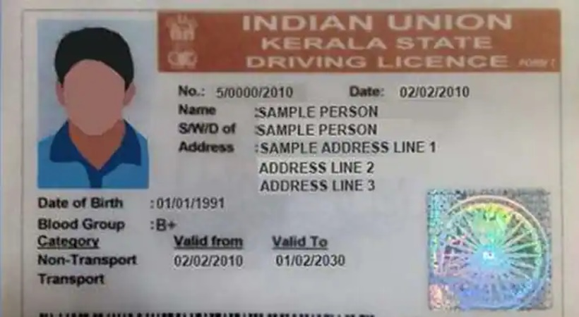
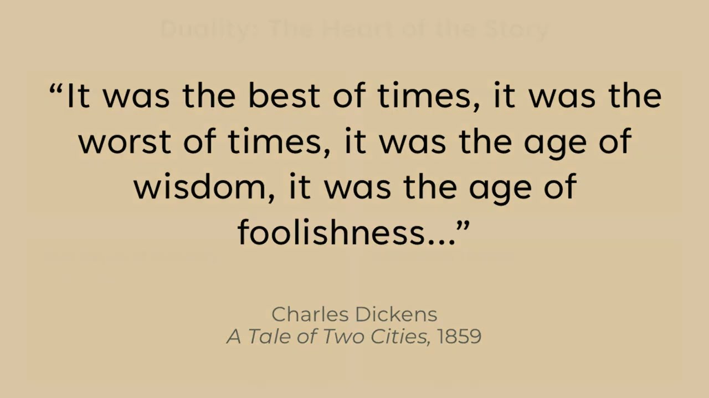
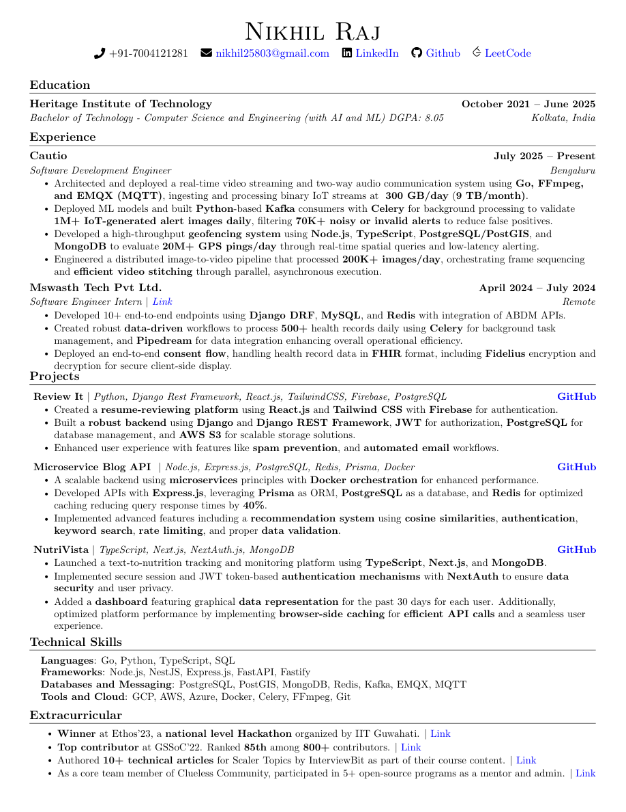

<h1 align="center">Akshara | अक्षर</h1>
<p align="center"><strong>From text to understanding.</strong></p>

<div align="center">

[](https://github.com/nikhil25803/akshara/actions/workflows/test.yml)
[](https://github.com/nikhil25803/akshara/actions/workflows/build.yml)
[](https://github.com/nikhil25803/akshara/releases)
[](https://www.python.org/)
[](https://fastapi.tiangolo.com/)
[](https://github.com/PaddlePaddle/PaddleOCR)
[](https://github.com/ggml-org/llama.cpp)
[](LICENSE)

<br>


</div>

## Table of contents

- [About](#about)
- [Features](#features)
- [Tech Stack](#tech-stack)
- [Quick Start](#quick-start)
- [Environment Variables](#environment-variables)
- [Deployment Resources](#deployment-resources)
- [Docker Run: OCR Only](#docker-run-ocr-only)
- [OCR API Documentation](#ocr-api-documentation)
- [Docker Run: OCR + llama.cpp](#docker-run-ocr--llamacpp)
- [LLM API Documentation](#llm-api-documentation)
- [Examples](#examples)
- [Contributing](#contributing)
- [Changelog](#changelog)
- [Security](#security)
- [Code of Conduct](#code-of-conduct)
- [License](#license)

## About

OCR can recover text, but applications need meaning, such as identifying an
expiry date instead of returning every string on a driving licence. Building
that understanding usually requires separate systems for document processing,
schema mapping, and language models.

Akshara provides that pipeline behind one local API. It combines secure OCR,
caller-defined JSON Schema extraction, and grounded one-shot questions through
an optional local llama.cpp model.

## Features

- JPEG, PNG, and PDF text extraction.
- Embedded PDF text extraction with scanned-page OCR fallback.
- Environment-controlled multilingual PaddleOCR.
- API-key authentication and upload, page, pixel, and concurrency limits.
- CPU-first Docker deployment with persistent model caching.
- Caller-defined JSON Schema extraction through llama.cpp.
- Grounded questions against an uploaded document.

## Tech Stack

| Layer                         | Technology                           |
| ----------------------------- | ------------------------------------ |
| Runtime                       | Python 3.11+                         |
| API framework                 | FastAPI                              |
| ASGI server                   | Uvicorn                              |
| OCR engine                    | PaddleOCR 3.x + PaddlePaddle 3.2 CPU |
| Document processing           | PyMuPDF + Pillow                     |
| Structured extraction and Q&A | llama.cpp + JSON Schema              |
| Configuration                 | Pydantic Settings                    |
| Dependency management         | uv                                   |
| Testing and linting           | pytest + Ruff                        |
| Container and registry        | Docker + GitHub Container Registry   |
| CI/CD                         | GitHub Actions                       |

## Quick Start

Install [Docker](https://docs.docker.com/get-started/get-docker/) and pull the
latest Linux AMD64 image from GitHub Container Registry:

```bash
docker pull ghcr.io/nikhil25803/akshara:latest
```

Use `ghcr.io/nikhil25803/akshara:0.0.4` instead of `:latest` for a reproducible
deployment.

## Environment Variables

| Variable                      | Required | Default               | Details                                                                          |
| ----------------------------- | -------- | --------------------- | -------------------------------------------------------------------------------- |
| `API_KEY`                     | `true`   | —                     | Secret with at least 32 characters; required by every endpoint except `/` and `/health` |
| `OCR_ENGINE`                  | `false`  | `paddleocr`           | OCR backend; PaddleOCR is currently supported                                    |
| `OCR_LANGUAGES`               | `false`  | `en,hi`               | Comma-separated language allowlist; the first language is the request default    |
| `OCR_MAX_CONCURRENT_REQUESTS` | `false`  | `1`                   | Maximum simultaneous OCR operations per process                                  |
| `MAX_FILE_SIZE_MB`            | `false`  | `25`                  | Maximum uploaded file size in MiB                                                 |
| `MAX_PDF_PAGES`               | `false`  | `50`                  | Maximum accepted PDF page count                                                   |
| `MAX_IMAGE_PIXELS`            | `false`  | `25000000`            | Maximum pixels per image or rendered PDF page                                     |
| `ENABLE_LLM`                  | `false`  | `false`               | Enables schema extraction and document questions                                 |
| `LLM_BACKEND`                 | `false`  | `llama_cpp`           | Local inference backend used when `ENABLE_LLM=true`                               |
| `LLM_MODEL_PATH`              | `false`  | `./models/model.gguf` | GGUF path; the file must exist when `ENABLE_LLM=true`                              |
| `LLM_DEVICE`                  | `false`  | `cpu`                 | Inference device; Linux AMD64 CPU is currently supported                          |

## Deployment Resources

| Mode                    | CPU    | Memory          | Guidance                                      |
| ----------------------- | ------ | --------------- | --------------------------------------------- |
| OCR development         | 1 vCPU | 2 GiB           | Small documents and low request volume        |
| OCR production baseline | 2 vCPU | 4 GiB           | One OCR operation at a time                   |
| OCR + llama.cpp         | Model-dependent | Model-dependent | Benchmark with the selected GGUF and workload |

Larger PDFs, additional cached languages, higher concurrency, and local LLM
inference require workload-specific sizing.

## Docker Run: OCR Only

Generate an API key in the current shell:

```bash
export API_KEY="$(openssl rand -hex 32)"
```

Create a persistent volume for PaddleOCR models:

```bash
docker volume create akshara-models
```

Start Akshara with llama.cpp disabled:

```bash
docker run --detach --rm --name akshara \
  --publish 8000:8000 \
  --env API_KEY \
  --env ENABLE_LLM=false \
  --env OCR_LANGUAGES=en \
  --volume akshara-models:/models \
  ghcr.io/nikhil25803/akshara:latest
```

PaddleOCR downloads its language models during the first startup. Follow the
logs until the server is ready:

```bash
docker logs --follow akshara
```

## OCR API Documentation

### `GET /health`

```bash
curl --request GET "http://127.0.0.1:8000/health"
```

```json
{
  "status": "ok",
  "paddleocr": true
}
```

### `POST /v1/ocr`

```bash
curl --request POST \
  --header "api_key: $API_KEY" \
  --form "file=@document.jpg" \
  "http://127.0.0.1:8000/v1/ocr?language=en&extraction_source=true"
```

```json
{
  "text": "Extracted document text...",
  "language": "en",
  "mime_type": "image/jpeg",
  "page_count": 1,
  "warnings": [],
  "pages": [
    {
      "page_number": 1,
      "extraction_source": "paddleocr"
    }
  ]
}
```

## Docker Run: OCR + llama.cpp

Stop the OCR-only container if it is running:

```bash
docker stop akshara
```

Export an API key if it is not already set in the current shell:

```bash
export API_KEY="${API_KEY:-$(openssl rand -hex 32)}"
```

Create the persistent model volume if it does not already exist:

```bash
docker volume create akshara-models
```

Create a local model directory:

```bash
mkdir -p models
```

Download the compact Qwen GGUF used by the integration workflow:

```bash
curl --location \
  --output models/model.gguf \
  "https://huggingface.co/Qwen/Qwen2.5-0.5B-Instruct-GGUF/resolve/9217f5db79a29953eb74d5343926648285ec7e67/qwen2.5-0.5b-instruct-q4_k_m.gguf"
```

Start Akshara with llama.cpp enabled:

```bash
docker run --detach --rm --name akshara \
  --publish 8000:8000 \
  --env API_KEY \
  --env ENABLE_LLM=true \
  --env OCR_LANGUAGES=en \
  --env LLM_BACKEND=llama_cpp \
  --env LLM_MODEL_PATH=/models/model.gguf \
  --env LLM_DEVICE=cpu \
  --volume akshara-models:/models \
  --volume "$PWD/models/model.gguf:/models/model.gguf:ro" \
  ghcr.io/nikhil25803/akshara:latest
```

Follow startup and model loading:

```bash
docker logs --follow akshara
```

The service is ready when `GET /health` returns:

```json
{
  "status": "ok",
  "paddleocr": true,
  "llama_cpp": true
}
```

## LLM API Documentation

### Schema-based extraction — `POST /v1/ocr/schema`

The JSON Schema is sent directly in the multipart request:

```bash
curl --request POST \
  --header "api_key: $API_KEY" \
  --form "file=@document.jpg" \
  --form 'schema={"type":"object","properties":{"issue_date":{"type":"string"},"date_of_expiry":{"type":"string"}},"required":["issue_date","date_of_expiry"],"additionalProperties":false};type=application/json' \
  "http://127.0.0.1:8000/v1/ocr/schema?language=en"
```

```json
{
  "issue_date": "02/02/2010",
  "date_of_expiry": "01/02/2030"
}
```

### Ask — `POST /v1/ocr/ask`

```bash
curl --request POST \
  --header "api_key: $API_KEY" \
  --form "file=@document.png" \
  --form-string "question=Who wrote this quote?" \
  "http://127.0.0.1:8000/v1/ocr/ask?language=en"
```

```json
{
  "answer": "Charles Dickens"
}
```

When the document does not contain a grounded answer, the endpoint returns
`{"answer":null}`.

## Examples

The repository includes three fixtures used by the OCR, schema, and question
integration workflows.

<table>
  <tr>
    <th>Driving licence</th>
    <th>Quote</th>
    <th>Resume PDF preview</th>
  </tr>
  <tr>
    <td><a href="assets/test/driving-licence.jpg"></a></td>
    <td><a href="assets/test/quote.png"></a></td>
    <td><a href="assets/test/NikhilRaj_Resume_SDE.pdf"></a></td>
  </tr>
  <tr>
    <td>JPEG · scanned document</td>
    <td>PNG · rendered quote</td>
    <td>PDF · embedded text</td>
  </tr>
</table>

### OCR only

| Fixture | MIME type | Extraction source | Pages | Representative content |
| ------- | --------- | ----------------- | ----: | ---------------------- |
| Driving licence | `image/jpeg` | `paddleocr` | 1 | Licence dates, holder details, and blood group |
| Quote | `image/png` | `paddleocr` | 1 | Charles Dickens quotation and attribution |
| Resume | `application/pdf` | `embedded_text` | 1 | Education, experience, projects, and skills |

### Schema-based extraction

| Fixture | Requested fields | Representative response |
| ------- | ---------------- | ----------------------- |
| Driving licence | Issue and expiry dates | `{"issue_date":"02/02/2010","date_of_expiry":"01/02/2030"}` |
| Quote | Author | `{"author":"Charles Dickens"}` |
| Resume | Companies | `{"companies":["Cautio","Mswasth Tech Pvt Ltd."]}` |

### Ask

| Fixture | Question | Representative answer |
| ------- | -------- | --------------------- |
| Driving licence | What is the blood group? | `B+` |
| Quote | Who wrote this quote? | `Charles Dickens` |
| Resume | Which companies are listed in the Experience section? | `Cautio and Mswasth Tech Pvt Ltd.` |

OCR text can vary slightly across PaddleOCR versions. JSON Schema constrains
the response shape, while the accuracy and wording of local-model responses can
vary; validate important extractions for your domain.

## Contributing

Development setup and pull-request guidance are in
[CONTRIBUTING.md](CONTRIBUTING.md).

## Changelog

Release history is maintained in [CHANGELOG.md](CHANGELOG.md).

## Security

Report vulnerabilities according to [SECURITY.md](SECURITY.md).

## Code of Conduct

Participation is governed by [CODE_OF_CONDUCT.md](CODE_OF_CONDUCT.md).

## License

Akshara is distributed under the [MIT License](LICENSE).
